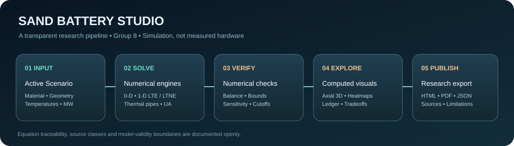

# Sand Battery Studio · v2.1 Premium Research Interface

**Web-first thermal engineering research — no installation, external account or sensor hardware required.**

[**Open the live web application**](https://sand-battery-project-a5twmepge6cqbndgbz9jmj.streamlit.app/) · [**GitHub repository**](https://github.com/bysquizy/Sand-Battery-Project) · [**Scientific methods**](docs/ADVANCED_RESEARCH_V2.md)

A lightweight, English-language, browser-based engineering simulation of **sensible thermal energy storage**. Visitors need no local installation. The five Python runtime dependencies remain Streamlit, NumPy, SciPy, Pandas and Plotly.

**Group 8:** Yağız Topaç · Semih Cenk · Fatma Ovacık.

> **Software research tool, not an experimentally validated industrial sand battery.** All energy, economic and material scenario results must be interpreted within their stated assumptions. A validated energy balance does not certify actual operating performance.

## Premium v2.1 experience

The entire nine-page interface now shares one accessible deep-navy/teal/copper
visual language, a source-aware footer, an escaped Active Scenario ribbon,
responsive spacing and consolidated onboarding. UI motion is short and respects
reduced-motion preferences. Native Streamlit controls remain accessible and
functional; static HTML/CSS is restricted to trusted layout and branding.

**Security refinements:** uploaded JSON/CSV inputs remain strictly validated;
any user-controlled scenario labels in downloadable comparison CSV are
escaped against spreadsheet-formula execution. Explicit Streamlit CORS/XSRF
protections are enabled. No JavaScript, CDN fonts or new runtime libraries.

See [UI and security audit](docs/PREMIUM_UX_AUDIT.md) and
[Equation-to-code traceability](docs/EQUATION_TRACEABILITY.md).

## Explore the site

| Workspace | What you can explore |
| --- | --- |
| **Engineering Dashboard** | 0-D charge/hold/discharge, useful heat, energy losses, Sankey balance, annotated temperature timelines, illustrative animated 3D silo and bounded material screening |
| **Visual Story Studio** | 1-D data-grounded 3D thermal animation, computed heatmaps, sensitivity/tornado and design-tradeoff figures, offline HTML/PDF/JSON scenario reports |
| **Model Verification** | 0-D vs 1-D model comparison, simplified closed-pipe heat transfer, cp(T) data integrity and numerical benchmarks | 
| **Scenario Manager** | Three A/B/C design snapshots, numerical KPI comparisons, versioned JSON import/export and CSV tables (browser session only) |
| **Thermal Design Studio** | Passive cooling, modular geometry, radial insulation temperature, geometric limits, target theoretical MWh volume sizing and scenario exports |
| **Advanced Research Lab** | Exergy, synthetic PV/wind dispatch, direct-contact LTNE, Ergun pressure loss, ideal ε–NTU exchanger, illustrative uncertainty and LCOH |
| **Material Atlas** | 18 sourced-or-assumption-labeled materials, cp(T) curves, temperature/capacity comparison, theoretical ideal mixtures |
| **Virtual Experiments** | Mesh-sensitivity comparison, air-flow/pressure resistance and insulation/standby case studies |
| **Research Hub** | Eight concise technical summaries, operating modes, equations, model boundaries, Finnish reference systems, the source-audit method, APA bibliography and a minimal Group 8 member section |

The **Research Hub is the single primary place for references and team information**. Duplicate academic project tabs were removed from the Dashboard to improve navigation. All three contributors are credited by the names supplied to the project.

### GitHub icon in Streamlit's upper toolbar

The built-in GitHub icon belongs to Streamlit Community Cloud and may use the repository connected to the deployment. Its destination **cannot be redirected by a Streamlit Python link**. To ensure a visible working link, the application includes an explicit **GitHub Repository** button pointing to [this repository](https://github.com/bysquizy/Sand-Battery-Project). If Streamlit's native GitHub button points elsewhere, the app owner must correct the connected GitHub deployment source in Streamlit Community Cloud.

## v2.0 release — visual engineering reports and trusted sources

- **Thermal animation:** the 1-D direct-contact solver now saves finite-volume
  temperature snapshots for charging, standby and discharge. Plotly displays
  the computed axial profile on an illustrative 3D cylinder, and provides a
  synchronized 2-D time/height heatmap. There is **no computed radial gradient,
  thermocouple network, CFD simulation or measured temperature field**.
- **Design exploration:** run explicitly requested ±10% sensitivity and
  source-limited storage-volume/insulation design screens. All output uses the
  same 0-D physics as the active scenario, not invented performance curves.
- **Downloadable reports:** self-contained UTF-8 HTML with an inline calculated
  SVG temperature plot, citations, project credits and energy ledger;
  dependency-free compact PDF; JSON scenario and CSV model outputs. The browser
  can print the richer HTML edition to PDF with full Unicode team names.
- **Evidence integrity:** Research Hub now uses source-attributed
  manufacturer/operator charts, not arbitrary 75/25 illustrative Sankey
  values. The unresolved Kankaanpää 200 versus 100 kW power distinction
  remains visible.
- **Clean publication:** GitHub README includes an original SVG workflow
  illustration; documentation explains equations, source evidence and model
  limits. Four UI/physics/research stages and publication QA are tracked;
  native page startup and export structures are checked by CI.
- **Web-first / five dependencies:** Streamlit, NumPy, SciPy, Plotly and
  Pandas. No browser account, persistent database, external chart fonts,
  Kaleido or PDF generation package is required.

[Equation traceability](docs/EQUATION_TRACEABILITY.md) ·
[v2.0 acceptance and test checklist](docs/RELEASE_2_0_QA.md) ·
[Historical release changes](CHANGELOG.md)

## Research foundation

The primary literature review is **Bošnjaković and Santa (2026)**, [*Sand Batteries for Thermal Energy Storage: A Review of Operating Principles, Technologies, Challenges and Future Perspectives*](https://doi.org/10.3390/cleantechnol8050165), *Clean Technologies, 8*(5), 165. Its main themes are charging/storage/discharging, fixed and thermocline beds, fluidized/moving beds, hybrid materials, modelling and AI, environmental/economic tradeoffs, safety, reliability and commercialization limitations. The project has **not** reproduced that copyrighted article; concise study notes in `research_notes.py` and `docs/RESEARCH_GUIDE.md` are derived interpretations with section references.

The submitted team sources include the *Polar Night Energy research summary* (manufacturer-sourced context), the *Enhanced Source Check Research Audit* (source reliability grades P1, P2, S1, S2, U and claim verdicts) and the original legacy Streamlit ZIP (calculation ideas, not field observations). Commercial claims are attributed rather than treated as calibration data.

- **Kankaanpää, Finland:** the Vatajankoski operator [reports 100 kW](https://www.vatajankoski.fi/en/projects/sand-battery/), while the Polar Night Energy developer [lists 200 kW](https://polarnightenergy.com/reference/worlds-first-sand-battery/); both mention 8 MWh. The discrepancy remains unresolved.
- **Pornainen, Finland:** [Polar Night Energy reports 1 MW and 100 MWh](https://polarnightenergy.com/reference/solution-for-clean-energys-big-problem/), with crushed soapstone.
- **NREL's particle storage work:** [report 84728](https://www.nrel.gov/docs/fy23osti/84728.pdf) discusses a specific high-purity silica sample. Our illustrative linear cp(T) is **not** the measured phase-transition curve around 573 °C.

[**Research summaries**](docs/RESEARCH_GUIDE.md) · [Equation and evidence mapping](docs/ADVANCED_RESEARCH_V2.md) · [Source register](docs/SOURCE_REGISTER.md) · [Legacy feature migration](docs/LEGACY_METHODS_PORTING.md) · [Limitations](docs/MODEL_VALIDATION.md)

## Calculation boundaries and reproducibility

- **Stored energy:** \(Q=m\int c_p(T)dT\), based on specified bulk material density and assumed property curves.
- **0-D thermal losses:** \(Q_{loss}=UA(T-T_{ambient})\), approximate cylindrical insulation geometry.
- **1-D LTE/LTNE:** direct-contact bed equations; **not** the same as the commercial embedded-pipe technology.
- **Exergy:** a thermodynamic upper bound, not electricity generated.
- **Costs:** hypothetical scenario inputs, not verified installed quotes.
- **Animated temperatures:** numerical illustration, not measured thermocouple points or CFD.

Python 3.13 GitHub Actions checks numerical results, imports, page navigation, CSV safety constraints, bounded plots and focused static analysis. Runtime dependencies are in `requirements.txt`; test-only tools are in `requirements-dev.txt`. Tests do **not** substitute for measurements. Team members should disclose permitted AI assistance according to their actual course/institution rules.

## Stage 3: scientific model verification

- Model Verification is a separate on-demand study workspace comparing 0-D uniform solid and 1-D direct-contact LTE physics, including configurable cutoffs.
- A **separate simplified closed-pipe model** uses convection, pipe-wall and effective-solid conduction resistances plus idealized thermal-loop effectiveness and an integrated energy ledger. This is **not CFD, commercial equipment validation, or measured plant performance**.
- A separate two-layer insulation calculator explores assumed conductivity, thickness, outside film resistance, layer-interface temperatures and total heat leakage; it does not change the existing one-layer baseline physics.\n- The tabulated cp(T) data interface exactly integrates piecewise-linear sensible heat within its declared range. The included demonstration knots are **hypothetical**, not measured NREL DSC data.
- Stage 1/2 refinements reject ambiguous duplicate JSON keys, avoid eager Research Lab calculations, and suppress stale Virtual Experiments results after scenario changes.
- See [Stage 3 engineering methods](docs/STAGE3_METHODS.md) and [Stage 3 verification](docs/STAGE3_VERIFICATION.md).

## Stage 2: shared design and faster navigation

- Open **Edit shared design** in the left navigation sidebar, set geometry,
  material, temperature range and charging source, then press **Apply to all pages**.
- The Dashboard and Thermal Design Studio use the active design directly.
  Material Atlas and Advanced Research Lab start from this baseline but offer
  clearly labelled **local exploratory overrides**.
- In **Scenario Manager**, save the current design as A, B or C, compare modeled
  capacity/useful heat/losses, and download `sand_battery_scenarios_v1.json`.
  Upload the same JSON to restore all three saved designs. No external
  account or permanent cloud database is required or implied.
- The Dashboard calculates and draws only the selected workspace; heavy
  charts/3D are no longer built while another dashboard section is active.
- Old beta release notes are preserved in [historical documents](docs/archive/).
  No active calculation engine `.py` files were deleted: they all remain imported.

The import validator rejects unknown fields, invalid values, non-finite
numbers, oversized JSON and mismatched schema versions. Imported settings are
recalculated by the same physics engine; imported result claims are not trusted.

## Stage 1 release: quality and security

- Hardened `available_mw,demand_mw` CSV import (1 MB and 8,760 hourly rows maximum; finite numeric range checks).
- Fixed Material Atlas temperature sweep so it never exceeds the selected maximum.
- Updated the Codespaces configuration to Python 3.13 without disabling web security protections.
- Centralized the version visible in the dashboard/JSON export, archived obsolete release chronology and revised the security and verification documents.
- **No changes** to source thermodynamic equations, physical parameter assumptions, or installed runtime dependencies.

[Stage 1 roadmap](docs/ROADMAP.md) · [Model limitations](docs/MODEL_VALIDATION.md) · [Current changelog](CHANGELOG.md)

There is **no general open-source license** pending contributor agreement. See [security](.github/SECURITY.md), [contributing](CONTRIBUTING.md), [changelog](CHANGELOG.md) and [software citation](CITATION.cff).
